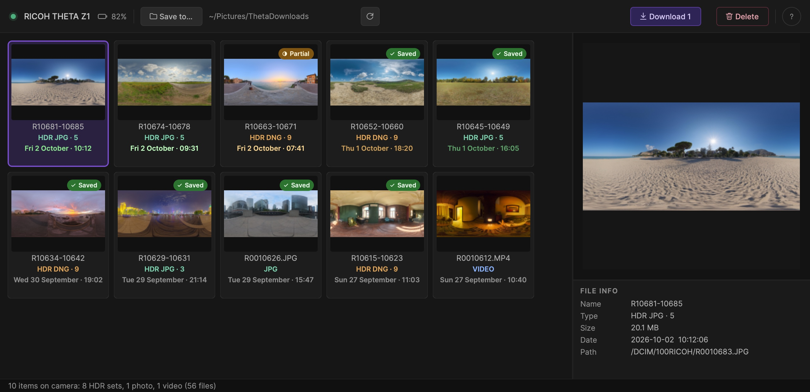

<p align="right"><b>English</b> · <a href="README_ES.md">Español</a></p>

# Theta Explorer

Browse and download the photos and videos on a **RICOH THETA** camera from macOS or Windows, over
USB. Made for HDRI work: each bracketed HDR sequence shows up as **one item**, previewed
with its middle exposure, and you can see at a glance which sets you already downloaded.



## Features

- **HDR sets as a single item.** Matching DNG and JPG bracketed sequences share one
  tile with its number of exposures. Download or delete that item to include both formats.
  Native camera brackets are recognized from their exposure metadata, including slower captures
  and custom exposure orders. Repeated exposure patterns and pauses distinguish consecutive captures.
- **RAW thumbnails** use the embedded preview when the camera cannot provide a thumbnail.
- **Preview and file info** for the selected item: name, type, size, date, resolution
  and path on the camera.
- **Panoramic preview** below the original JPEG. DualFisheye images get an approximate
  stitched preview; images already stitched keep their existing panorama. This is a
  preview with visible seams, without optical calibration or HDR exposure merging.
- **Persistent download history.** Verified downloads are marked *Downloaded*, or
  *Partial* when only some files were downloaded. File Info shows the last download
  date. These marks survive moving or deleting your download folder.
- **Recent captures stand out.** A capture's date starts bright green (amber for DNG) and
  fades over 28 hours, so a fresh shoot is easy to find.
- **Folders by format.** DNG and JPG files keep their own folders, named after the
  capture date and files, for example `HDRI_260402_R21381-21389_dng` for an HDR set.
- **Safe re-downloads.** If some files are already on disk you can skip them and get only
  what's missing (this completes a half-downloaded set) or replace the local copy.
- **Delete from the camera** with a confirmation that tells you how many files will go.
  Enter cancels; deleting always takes a click.
- **Camera controls above the Viewer**, leaving the tile browser at full height.
  Battery, Refresh, Help, save destination, Download and Delete stay together.
- **Automatic update checks**, with manual checking and an on/off preference in Help.
  You choose when to download and install a newer release.

## Requirements

- macOS 12 or later, on Apple Silicon or Intel, or Windows 10/11 64-bit.
- Windows uses Windows Portable Devices; physical THETA validation on Windows is pending.
- A RICOH THETA connected by USB and turned on. Tested with the **THETA Z1**.

## Install

This new repository has no published release packages yet. You can build from source
using the scripts below. Future packages will appear on the Releases page.

1. Download `LGA_ThetaExplorer_Mac_v<version>.dmg` from
   [Releases](../../releases/latest).
2. Open it and drag **LGA ThetaExplorer** onto **Applications**.
3. Open the app from Applications.

The app is not notarized by Apple. If macOS says it can't be opened or that it is
damaged, run this in Terminal and open it again:

```bash
sudo xattr -cr "/Applications/LGA ThetaExplorer.app"
```

It only removes the quarantine flag that macOS adds to downloaded files, from this copy
of the app. It doesn't turn off Gatekeeper.

The first time, macOS may ask for permission to access the camera: the app needs it to
read the files on the THETA.

## Use

1. Connect the camera. Its photos and videos appear as tiles; HDR sequences appear as a
   single tile.
2. Click the **Save to** destination above the Viewer to choose where to save.
3. Select one or more items and press **Download**, or **Delete** to remove them from the
   camera.

| Shortcut | Action |
|---|---|
| `⌘A` / `Ctrl+A` | Select all items |
| `Esc` | Clear the selection |
| `⌘?` / `F1` | Open the Help |

The Help window also shows where the app keeps its files, and opens them in Finder:

- Settings: `~/Library/Application Support/LGA/ThetaExplorer/`
- Log: `~/Library/Logs/LGA/ThetaExplorer/debug.log`

Download history is stored next to settings in `download-history.json`
(`%APPDATA%\LGA\ThetaExplorer` on Windows). It belongs to this computer, tracks
each camera separately and starts with downloads made by this version. Existing
files and previews do not create historical records. A historical mark never skips
a new download; Skip Existing checks the actual files in the chosen destination.

In Help, **Check now** looks for a newer published release. Automatic checking is on by
default. When an update is available, choose **Update now**, **Remind me later**, **Skip
this version**, or **Cancel**. Updates apply to installed copies; builds in the source or
build folder keep their development version. Finish camera downloads or deletions and
close other copies before installing an update.

## Build from source

On macOS, requires Xcode command line tools, CMake and Qt 6.5.3 at `~/Qt/6.5.3/macos`.

```bash
./compilar.sh
```

builds a Debug universal binary (arm64 + x86_64) in `build/`, signs it and launches it
in the background. Use `--no-run` to build without launching, `--wait` to wait for the
app to close, or `--release` to build Release in `build-release/`. `./deploy.sh`
builds the Release version and packages the DMG.

On Windows, use Qt 6.5.3 `mingw_64`, MinGW 13.1 and Ninja, then run `compilar.bat`.
The default paths match the other LGA apps. Debug and Release have separate folders;
`--no-run`, `--wait`, `--release` and `--parallel N` are supported.
See [Windows backend and build](doc/windows.md) for details and validation limits.

## Credits

The HDRIs in the screenshot are from [Poly Haven](https://polyhaven.com) (CC0): Spiaggia di
Mondello, Sunflowers, Venice Sunset, Golden Gate Hills, Autumn Park, The Sky Is On Fire,
Shanghai Bund, Canary Wharf, Fireplace and Photo Studio Loft Hall.

## Author

Developed by Lega Pugliese — [lega.com.ar](https://lega.com.ar)
